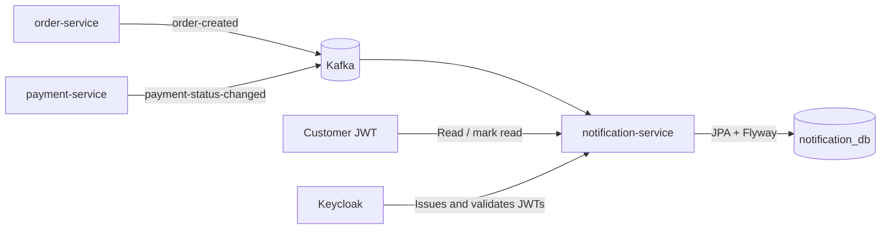
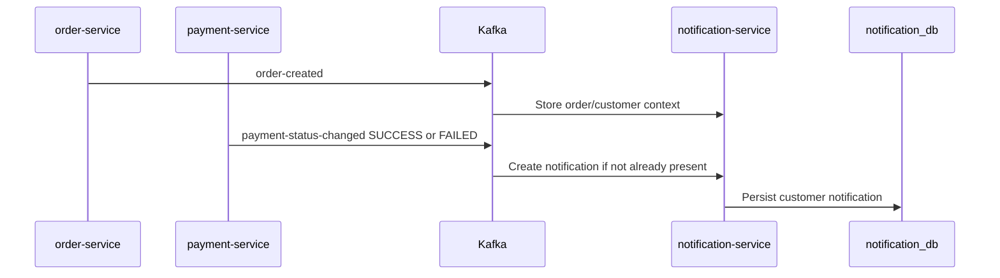
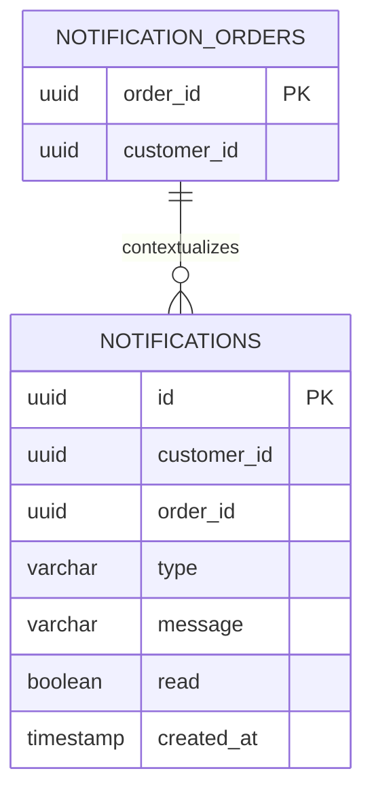

# SpareLink Notification Service

[](https://github.com/tadiwanashe-mashongwa/notification-service/actions/workflows/ci.yml)
[](https://github.com/tadiwanashe-mashongwa/notification-service/actions/workflows/ci.yml)
[](https://openjdk.org/projects/jdk/21/)
[](https://spring.io/projects/spring-boot)

Notification Service owns customer-facing notifications for SpareLink. It consumes order and payment events, records notifications idempotently, and exposes each customer’s private notification inbox.

## Responsibilities

- Consumes `order-created` to establish order/customer notification context.
- Consumes `payment-status-changed` and creates one notification for each supported terminal payment outcome.
- Prevents duplicate notifications with a database constraint and service-level idempotency check.
- Lets an authenticated customer list only their own notifications and mark only their own notifications as read.
- Owns `notification_db`; no other service reads or writes its tables.

## Stack

Java 21, Spring Boot 3.5.5, PostgreSQL, JPA/Hibernate, Flyway, Kafka, Spring Security OAuth2 Resource Server, OpenAPI, Testcontainers, Docker, GitHub Actions, and JaCoCo.

## Architecture



## Event flow



## API and security

The service validates Keycloak JWTs. A notification is always scoped to the JWT subject, so a customer cannot read or update another customer’s inbox.

| Method | Endpoint | Access | Purpose |
| --- | --- | --- | --- |
| `GET` | `/api/notifications` | Authenticated customer | List own notifications, newest first |
| `GET` | `/api/notifications/unread` | Authenticated customer | List own unread notifications |
| `PATCH` | `/api/notifications/{notificationId}/read` | Authenticated customer | Mark one own notification as read |
| `GET` | `/actuator/health` | Public | Liveness/readiness health |
| `GET` | `/v3/api-docs` | Public | OpenAPI document |
| `GET` | `/swagger-ui/index.html` | Public | Swagger UI |

## Events

| Direction | Topic | Event | Effect |
| --- | --- | --- | --- |
| Consumed | `order-created` | `OrderCreatedEvent` | Saves order/customer context |
| Consumed | `payment-status-changed` | `PaymentStatusChangedEvent` | Creates `PAYMENT_SUCCEEDED` or `PAYMENT_FAILED` notification |

## Database model



## Run locally

Run the complete platform from the parent SpareLink repository:

```powershell
docker compose up --build -d
```

The service is available at `http://localhost:8087`.

| Resource | URL |
| --- | --- |
| Health | `http://localhost:8087/actuator/health` |
| OpenAPI JSON | `http://localhost:8087/v3/api-docs` |
| Swagger UI | `http://localhost:8087/swagger-ui/index.html` |

If the existing local PostgreSQL volume was created before this service was added, create its database once:

```powershell
docker compose exec postgres createdb -U postgres notification_db
```

## Tests

```powershell
mvn test
```

The suite covers domain rules, service idempotency and ownership, controller contracts, Flyway/JPA persistence, direct Kafka listener handling, and end-to-end Kafka/PostgreSQL Testcontainers integration. The JaCoCo HTML report is generated at `target/site/jacoco/index.html`.

## Project structure

```text
src/main/java/com/example/notificationservice
├── config          security configuration
├── consumer        Kafka event consumers
└── notification    domain, persistence, service, and HTTP API
```
